<picture><source media="(prefers-color-scheme: dark)" srcset="docs/assets/scene-dark.svg"></picture>

  <a href="https://sasitha-ruween.vercel.app">Portfolio</a> &nbsp;&nbsp;
  <a href="https://www.linkedin.com/in/sasitha-ruween-1752502b3">LinkedIn</a> &nbsp;&nbsp;
  <a href="mailto:sasitharuween@gmail.com">Email</a>

<picture><source media="(prefers-color-scheme: dark)" srcset="docs/assets/skyline-dark.svg"></picture>
<picture><source media="(prefers-color-scheme: dark)" srcset="docs/assets/work-dark.svg"></picture>
<picture><source media="(prefers-color-scheme: dark)" srcset="docs/assets/growth-dark.svg"></picture>
<picture><source media="(prefers-color-scheme: dark)" srcset="docs/assets/badges-dark.svg"></picture>
<picture><source media="(prefers-color-scheme: dark)" srcset="docs/assets/stack-dark.svg"></picture>
<a href="https://github.com/Sasitha-Ruvin/lk-holidays"><picture><source media="(prefers-color-scheme: dark)" srcset="docs/assets/holidays-dark.svg"></picture></a><a href="https://github.com/Sasitha-Ruvin/student-management-system"><picture><source media="(prefers-color-scheme: dark)" srcset="docs/assets/students-dark.svg"></picture></a>
