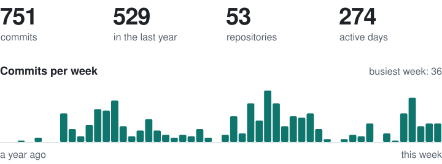
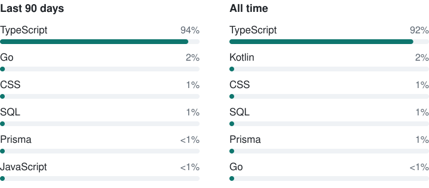

<picture>
  <source media="(prefers-color-scheme: dark)" srcset="assets/hero-dark.svg">
  
</picture>

I build ERP and CRM systems, client websites and AI-powered automation, and I write firmware for machinery too. Right now I'm exploring applied AI, voice agents and scalable architectures. BSc (Hons) Computer Science.

[Portfolio](https://sasitha-ruween.vercel.app) &nbsp;·&nbsp; [LinkedIn](https://www.linkedin.com/in/sasitha-ruween-1752502b3) &nbsp;·&nbsp; [Email](mailto:sasitharuween@gmail.com)

## Activity

<picture>
  <source media="(prefers-color-scheme: dark)" srcset="assets/activity-dark.svg">
  
</picture>

## Languages

<picture>
  <source media="(prefers-color-scheme: dark)" srcset="assets/langs-dark.svg">
  
</picture>

Share of my commits by language, across public and private work. Generated code excluded. [How it's counted](scripts/stats.mjs)

## Stack

| | |
|---|---|
| **Backend** | Go, NestJS, Node.js, Spring, PostgreSQL, Redis, Prisma, Supabase |
| **Web** | TypeScript, React, Next.js, Angular, Tailwind CSS |
| **Mobile and desktop** | Kotlin, Flutter, Java, C# |
| **Infrastructure** | AWS, Docker, Git |

## Open source

- **[lk-holidays](https://github.com/Sasitha-Ruvin/lk-holidays)**: Sri Lankan public, bank and mercantile holidays, with working-day helpers for payroll and attendance. Zero dependencies.
- **[student-management-system](https://github.com/Sasitha-Ruvin/student-management-system)**: students, batches, attendance and admin workflows in a web app.
