<picture>
  <source media="(prefers-color-scheme: dark)" srcset="docs/assets/header-dark.svg">
  
</picture>

<picture>
  <source media="(prefers-color-scheme: dark)" srcset="docs/assets/streak-dark.svg">
  
</picture>

<picture>
  <source media="(prefers-color-scheme: dark)" srcset="docs/assets/skyline-dark.svg">
  
</picture>

<picture>
  <source media="(prefers-color-scheme: dark)" srcset="docs/assets/languages-dark.svg">
  
</picture>

<picture>
  <source media="(prefers-color-scheme: dark)" srcset="docs/assets/rhythm-dark.svg">
  
</picture>

  <a href="https://sasitha-ruween.vercel.app">Portfolio</a> &nbsp;&nbsp;
  <a href="https://www.linkedin.com/in/sasitha-ruween-1752502b3">LinkedIn</a> &nbsp;&nbsp;
  <a href="mailto:sasitharuween@gmail.com">Email</a>

