Software engineer in Colombo, building ERP, CRM and AI systems with Go and TypeScript.

[Portfolio](https://sasitha-ruween.vercel.app) &nbsp;&nbsp; [LinkedIn](https://www.linkedin.com/in/sasitha-ruween-1752502b3) &nbsp;&nbsp; [Email](mailto:sasitharuween@gmail.com)

 

<picture>
  <source media="(prefers-color-scheme: dark)" srcset="assets/overview-dark.svg">
  
</picture>

 

<picture>
  <source media="(prefers-color-scheme: dark)" srcset="assets/calendar-dark.svg">
  
</picture>

 

<picture>
  <source media="(prefers-color-scheme: dark)" srcset="assets/languages-dark.svg">
  
</picture>

 

More

 

<picture>
  <source media="(prefers-color-scheme: dark)" srcset="assets/months-dark.svg">
  
</picture>

**Backend** Go, NestJS, Node.js, Spring, PostgreSQL, Redis, Prisma, Supabase 
**Web** TypeScript, React, Next.js, Angular, Tailwind CSS 
**Mobile and desktop** Kotlin, Flutter, Java, C# 
**Infrastructure** AWS, Docker, Git

**Open source** [lk-holidays](https://github.com/Sasitha-Ruvin/lk-holidays), [student-management-system](https://github.com/Sasitha-Ruvin/student-management-system)

[Interactive dashboard](https://sasitha-ruvin.github.io/Sasitha-Ruvin/)
